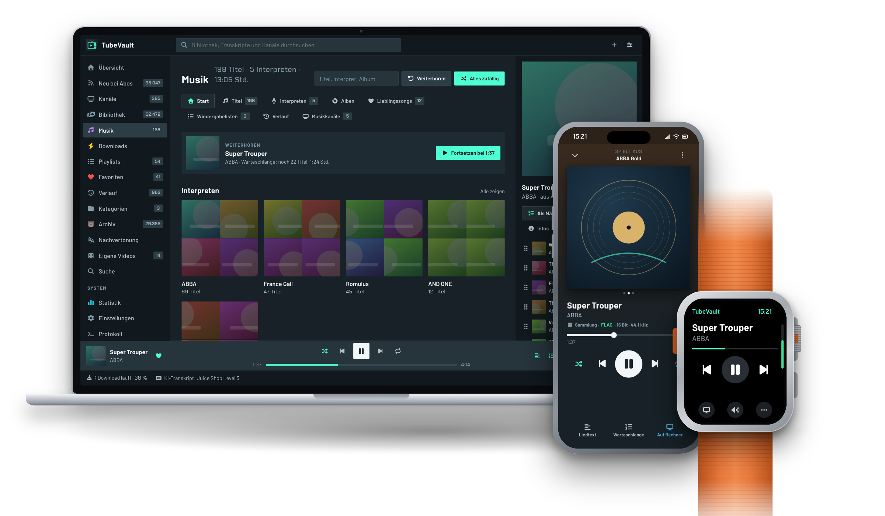
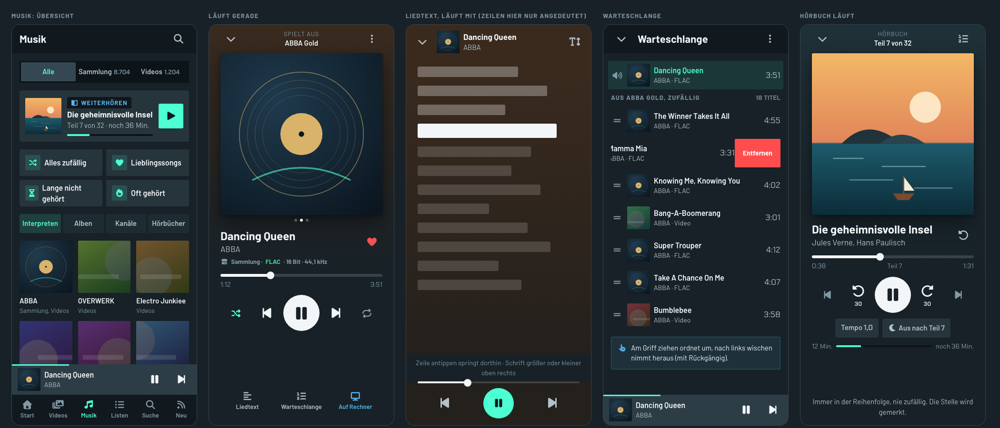
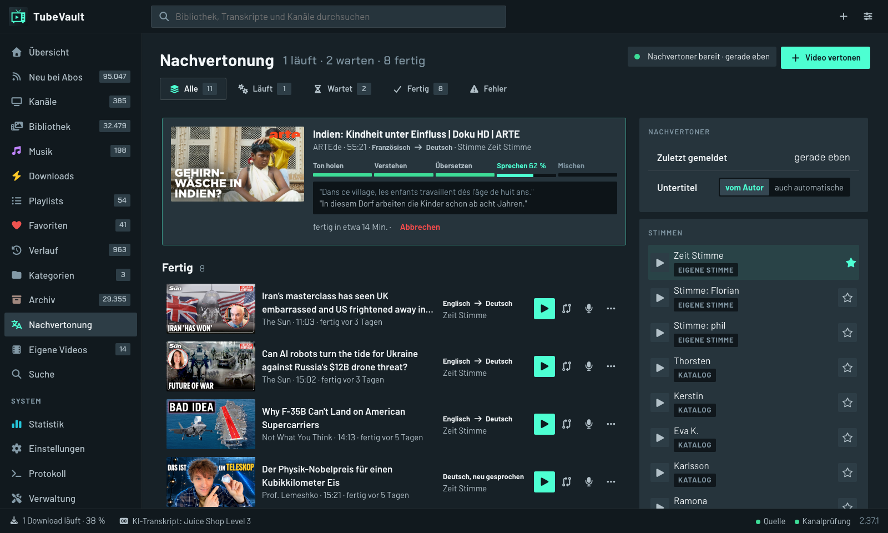
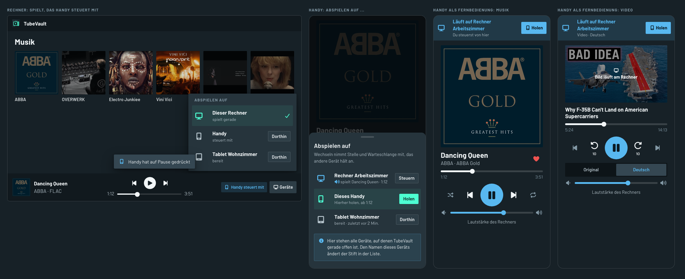

# TubeVault

**Das eigene Videoarchiv für zu Hause.** Abonnieren, laden, ansehen, hören und durchsuchen, alles auf eigener Hardware und ohne fremde Dienste dazwischen. TubeVault ist für den Raspberry Pi 5 gebaut und läuft überall, wo Docker läuft.



## Auf einen Blick

- **Abos, die sich selbst pflegen:** Neue Videos kommen per Feed, Downloads laufen in schonenden Portionen. Je Kanal zeigt eine Medaille, wie vollständig er ist.
- **Bibliothek mit Gedächtnis:** Kategorien mit Regeln, Favoriten, Playlists und Verlauf. Weiterschauen klappt an der gemerkten Stelle.
- **Suchen nach Wort und nach Bedeutung:** Volltext über Titel, Beschreibungen und Transkripte. Dazu kommt eine lokale KI, die auch inhaltlich Verwandtes findet.
- **Musik und Hörbücher:** Musikvideos und die eigene FLAC-Sammlung bilden eine Bibliothek. Hörbücher haben einen eigenen Bereich und laufen in ihrer Reihenfolge.
- **Nachvertonung:** Fremdsprachige Videos bekommen eine deutsche Tonspur, die sich in der Wiedergabe umschalten lässt.
- **Handy und Rechner zusammen:** Das Handy steuert die Wiedergabe am Rechner. Die Wiedergabe wechselt mit Stelle und Warteschlange zwischen den Geräten, in beide Richtungen.
- **Daten, die bleiben:** Neben jedem Video liegen die Metadaten als Datei. Täglicher Export der eigenen Daten, wöchentliche Sicherung und kompletter Wiederaufbau aus den Dateien.

## Funktionen

### Abonnieren und laden

- **Feed mit Reitern:** Aktiv, Später, Weggelegt und Ausgeblendet, nach Datum gruppiert. Filter nach Art, Kanal und Dauer, Aktionen für viele Videos auf einmal.
- **Schonende Abfragen:** Ein eigener Zeitplaner fragt die Kanäle in kleinen Portionen ab. Bei Drosselung pausiert er, statt Videos fälschlich als unerreichbar abzulegen.
- **Gestaffelte Downloads:** Kanäle und Playlists geben ihre Videos in einer festen Menge je Tag an die Warteschlange, bis alles da ist. Die Warteschlange kennt Prioritäten, Wiederholungen und eine einstellbare Pause.
- **Medaillen je Kanal:** Gezählt werden nur Hauptvideos, keine Shorts und keine Livestreams. Gold heißt lückenlos, Silber fehlen höchstens 5 %, Bronze höchstens 20 %. Dauerhaft nicht ladbare Videos zählen nicht als Lücke.
- **Gelöscht bleibt gelöscht:** Von gelöschten Videos bleiben die Metadaten und die eigenen Angaben erhalten. Die Automatik lädt sie nie wieder, nur ein ausdrücklicher Wunsch.

### Bibliothek, Ordnung und Suche

- **Bibliothek und Archiv:** Endloses Nachladen, Schlagwörter und Mehrfachfilter nach Art, Kanal, Kategorie und Musik. Die Sortierung bleibt gemerkt, mit Auswahlmodus für Aktionen auf vielen Videos.
- **Kategorien mit Regeln:** Ein Video kommt hinein, wenn eine Regel passt: "Kanal ist", "Schlagwort enthält" oder "inhaltlich wie". Von Hand Zugeordnetes hat immer Vorrang. Auf Wunsch schlägt die lokale KI passende Themen vor.
- **Favoriten, Playlists und Verlauf:**
  - einheitlich bedienbar: Abspielen, Zufall, Weiter an der gemerkten Stelle, Umordnen durch Ziehen, als gesehen markieren;
  - der Verlauf ist nach Tagen gegliedert und lässt sich pausieren.
- **Serien erkennen:** Nummerierte Folgen werden je Kanal zusammengefasst und als Playlist in Folgenreihenfolge angelegt.
- **Zweifache Suche:**
  - Die Wortsuche findet Wortanfänge und Teilwörter in Bibliothek, Archiv und Transkripten.
  - Die Bedeutungssuche mit lokaler KI erfasst auch Kanalbeschreibungen, Playlists, Liedtexte und den Feed.
  - Unter "Passt außerdem" zeigt sie Kanäle und Listen, die zur Frage passen.
  - Ohne KI bleibt die Wortsuche voll nutzbar.

### Ansehen

- **Wiedergabe:** Kapitel und Untertitel, mitlaufendes Transkript und Notizen in Markdown. Bekannte Werbestellen werden übersprungen.
- **Warteschlange:** Die Wiedergabe-Warteschlange aus Playlist, Favoriten oder Kategorie übersteht auch ein Neuladen der Seite.
- **Downloads aus der Wiedergabe:** Video und Ton lassen sich direkt aus der Wiedergabe laden.
- **Einordnung nach Quelle:** Ob Video, Short oder Livestream, sagt die Quelle selbst. Shorts lassen sich überall ausblenden.

### Musik und Hörbücher



- **Zwei Quellen, eine Bibliothek:**
  - Musikvideos und die eigene Sammlung (FLAC, MP3, M4A, OGG und weitere) erscheinen gemeinsam.
  - Mit einem Schalter: alles, nur die Sammlung oder nur die Videos.
  - Gibt es einen Titel doppelt, gewinnt die Datei.
- **Alles aus den Dateien:**
  - Interpret, Album, Titelnummer und Jahr kommen aus den Tags.
  - Das Cover ist eingebettet oder liegt als `cover.jpg` im Ordner.
  - Der Liedtext kommt aus einer `.lrc`-Datei und läuft mit.
  - Angezeigt werden auch Format, Bittiefe und Abtastrate.
- **Mixe und Gruppen:**
  - Mixe: Alles zufällig, Lieblingssongs, Lange nicht gehört, Oft gehört.
  - Gruppen: Interpreten, Alben und Musikkanäle.
  - Ein Album sind die Titel mit gleichem Cover, auch ein Sampler mit vielen Interpreten.
  - Das Minus blendet einen Titel überall in der Musik aus, mit Rückgängig; gelöscht wird nichts.
  - "Gefällt nicht" löscht ein Video, ebenfalls mit Rückgängig.
  - "Zur Stelle" zeigt den laufenden Titel in seiner Liste, "Zur Liste" legt ihn in eine Wiedergabeliste.
- **Mitnehmen:** einzelne Tondateien oder ganze Listen als ZIP, im Original oder umgewandelt.
- **Hörbücher getrennt von Musik:**
  - Hörbücher und Hörspiele landen nie in Musiklisten oder Mixen.
  - Sie laufen streng in ihrer Reihenfolge und nie zufällig.
  - Weiterhören setzt am gemerkten Teil an der gemerkten Stelle ein.
  - Erkannt werden sie in Ordnern der Sammlung und als Videos.

### Nachvertonung



Fremdsprachige Videos bekommen eine deutsche Tonspur:

- Ein eigenes Programm auf einem anderen Rechner übernimmt die Aufträge, sobald es Kapazität hat.
- Es holt den Ton, versteht, übersetzt, spricht und mischt.
- Die neue Tonspur ist in der Wiedergabe umschaltbar, das Video wird nicht doppelt gespeichert.
- Stimmen haben eine Hörprobe, eine davon ist vorausgewählt.
- Original und Vertonung lassen sich an derselben Stelle vergleichen.

Die Nachvertonung ist eine abschaltbare Erweiterung.

### Handy und Rechner



- **Eigene Handy-Ansicht** unter `/m`: reduziert auf Ansehen, Hören, Suchen und Neues laden. Telefone landen automatisch dort. Die Ansicht lässt sich als App auf den Startbildschirm legen.
- **Fernsteuerung:**
  - Jedes Gerät, auf dem TubeVault offen ist, meldet sich beim Server; Koppeln ist nicht nötig.
  - Spielt der Rechner, wird das Handy zur Fernbedienung: Pause, Weiter, Stelle, Lautstärke.
  - Bei Videos kommen Sprünge um 10 Sekunden und die Tonspur Original oder Deutsch dazu.
- **Übergabe:**
  - "Holen" übernimmt die Wiedergabe aufs Handy, mit Stelle und Warteschlange.
  - "Abspielen auf" schickt sie an den Rechner oder ans Tablet.
  - Das bisherige Gerät hält dann an.

### Eigene Videos und Datensicherheit

- **Alte Bestände einordnen:**
  - Videodateien von einer Platte werden eingelesen; Doppeltes lässt sich löschen, Bekanntes übernehmen.
  - Eigenes wird einem Kanal zugeordnet.
  - `info.json` und NFO-Dateien gelten dabei als verlässlichste Quelle.
- **Inhalte als Datei:**
  - Neben jedem Video liegen `info.json`, Beschreibung und Kapitel als Datei und bleiben bei jeder Änderung aktuell; die Datenbank ist Index und Suche.
  - Was bei einem älteren Bestand noch fehlt, schreibt der Hintergrund von selbst nach.
  - Favoriten, Verlauf, Playlists, Kategorien und Abos gehen täglich als JSONL-Export auf die Platte.
- **Wiederaufbau:** Unter Einstellungen > System lässt sich die Datenbank vollständig aus den Dateien neu aufbauen, mit Probelauf; Nutzerdaten lassen sich dort sichern und zurückspielen.
- **Sicherung:** wöchentlich, mit Rotation und Prüfung der Unversehrtheit. Beim Start wird geprüft, ob die richtige Datenbank angebunden ist.
- **Sichtbare Arbeit:**
  - Lange Vorgänge zeigen Stand, Laufzeit und Restdauer in der Statusleiste.
  - Ein Live-Protokoll zeigt aufklappbare Fehlerdetails und die laufenden Dienste.

## Technik

| Schicht | Technik |
|---|---|
| Backend | Python 3.12, FastAPI, SQLite (aiosqlite), FFmpeg, yt-dlp, mutagen |
| Frontend | Svelte 5 (Runes), Vite, Nginx |
| Abrufschutz | Token-Dienst als eigener Container, Deno für Prüfaufgaben |
| Betrieb | Docker Compose, Ports 8031 (API) und 8032 (Oberfläche) |

## Schnellstart

```bash
cp .env.example .env   # Ordner für Index und Medien sowie die Angaben des Nachvertoners eintragen
./einrichten.sh        # legt die Ordner an, baut und startet (docker compose up -d --build)
```

Danach ist die Oberfläche unter `http://<host>:8032` erreichbar, die API-Dokumentation unter `http://<host>:8031/docs`.
Die ganze Einrichtung mit Zugängen, Zeitplänen und Sicherung beschreibt [HANDBUCH.md](HANDBUCH.md).

## Speicher

TubeVault trennt Index und Medien bewusst auf zwei Platten:

| Was | Wohin | Angabe in der `.env` | Beispiel |
|---|---|---|---|
| Index: Datenbank, Vorschaubilder, Texte | schnelle Platte | `TUBEVAULT_INDEX` | `/srv/tubevault` |
| Medien: Videos, Ton, Untertitel, Sicherungen | große Platte | `TUBEVAULT_MEDIEN` | `/mnt/platte/tubevault` |

Beide Ordner sind Pflicht: `docker-compose.yml` hängt sie ein und startet ohne sie nicht. Vorlage ist `.env.example`
(dort auch die Angaben des Nachvertoners); die `.env` liegt neben `docker-compose.yml` und nie im Repo. Die Datenbank ist nur der Index. Beschreibungen, Kapitel und Notizen liegen als Dateien im Texte-Verzeichnis, die Metadaten zusätzlich als `info.json` neben jedem Video.

Zwei Quellen lassen sich wahlweise in der `.env` einbinden, beide nur lesend:

```bash
# Alte Videodateien, eingeordnet unter "Eigene Videos"
TUBEVAULT_SCAN_SOURCE=/mnt/platte/alte-videos

# Eigene Musiksammlung, erscheint in der Musik
TUBEVAULT_MUSIC_SOURCE=/mnt/platte/musik
```

Ordner der obersten Ebene bei alten Videos gelten als Hinweis auf den Kanal, etwa `ARTE/...`. In der Musiksammlung macht ein Ordner mit "Hörbuch" oder "Hörspiel" im Namen seinen Inhalt zum Hörbuch.

## Entwicklung

Tests laufen lokal gegen eine Wegwerf-Datenbank, nie gegen echte Daten:

```bash
make -C backend venv          # einmalig: Testumgebung anlegen
make -C backend test          # Backend
npm --prefix frontend test    # Frontend
```

`scripts/dev_seed.py` legt eine Testdatenbank unter `data/dev` an, um die Oberfläche ohne echte Daten auszuprobieren. Aufruf und Start stehen im Skript.

Die Version hat genau eine Quelle, `version.json`. Backend und Frontend tragen Spiegel davon:

```bash
scripts/bump.sh patch         # Fehlerbehebung
scripts/bump.sh minor         # neue Funktion
bash .githooks/install.sh     # einmalig: Prüfungen vor Commit und Push einschalten
```

Entwürfe neuer Oberflächen liegen als klickbare HTML-Seiten in `mockups/`.

```
tubevault/
├── backend/
│   ├── app/
│   │   ├── main.py         # Start, Hintergrundarbeiten
│   │   ├── config.py       # Konfiguration
│   │   ├── database.py     # Schema und Migrationen
│   │   ├── routers/        # API-Endpunkte, dünn
│   │   ├── services/       # Fachlogik: Downloads, Feed, Musik, Suche ...
│   │   └── utils/
│   └── tests/              # pytest
├── frontend/
│   └── src/
│       ├── routes/         # Seiten
│       ├── mobile/         # Handy-Ansicht
│       └── lib/            # Bausteine, Stores, API
├── mockups/                # Entwürfe
├── scripts/                # Wartung, Version, Testdaten
├── config/                 # Laufzeit-Konfiguration
└── docker-compose.yml
```

## Lizenz

**Nicht-kommerzielle Nutzung** - siehe [LICENSE](LICENSE)

Erlaubt: Private Nutzung, Installation, persönliche Anpassungen, Teilen mit Quellenangabe

Verboten: Kommerzielle Nutzung, Verkauf, Einbindung in kommerzielle Produkte

---

## Unterstützen

TubeVault ist ein privates Hobby-Projekt. Kein Tracking, keine Werbung, keine Kompromisse.

Wenn dir das Projekt gefällt, kannst du ihm einen Stern geben - oder direkt hier:

[](https://ko-fi.com/HalloWelt42)

**Crypto:**

| Coin | Adresse |
|------|---------|
| BTC | `bc1qnd599khdkv3v3npmj9ufxzf6h4fzanny2acwqr` |
| DOGE | `DL7tuiYCqm3xQjMDXChdxeQxqUGMACn1ZV` |
| ETH | `0x8A28fc47bFFFA03C8f685fa0836E2dBe1CA14F27` |

Copyright (c) 2025-2026 HalloWelt42
